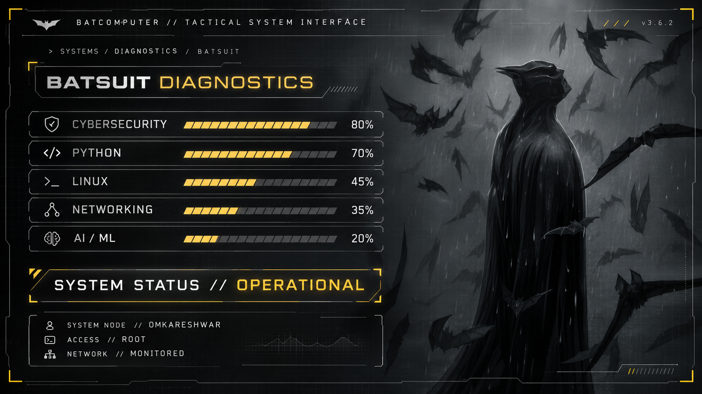
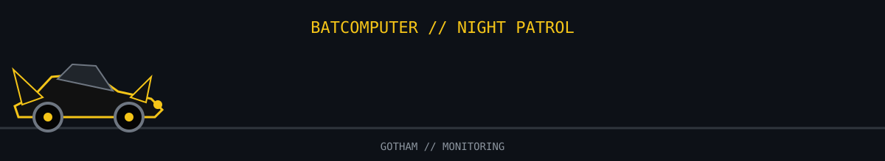

<!-- ============================================================ -->
<!--          OMKARESHWAR CHAUBEY // BATCOMPUTER                 -->
<!-- ============================================================ -->

<div align="center">


<br><br>

<h1>OMKARESHWAR CHAUBEY</h1>

<h3>🦇 BATCOMPUTER // ONLINE 🦇</h3>

<b>CYBERSECURITY • DEVELOPMENT • SYSTEMS • INTELLIGENCE</b>

<br><br>


<br><br>


&nbsp;

&nbsp;


<br><br>

<i>"It's not who I am underneath, but what I do that defines me."</i>

<br><br>

</div>

---

<div align="center">

## 🦇 BATCOMPUTER // IDENTITY

</div>

```bash
┌──[ BATCAVE // TERMINAL ]
│
│  Establishing encrypted connection...
│
├── OPERATOR ............. OMKARESHWAR CHAUBEY
├── DESIGNATION .......... COMPUTER SCIENCE ENGINEER
├── ACADEMIC TRACK ....... B.TECH CSE
├── SPECIALIZATION ....... CYBERSECURITY & PENTESTING
├── PRIMARY LANGUAGE ..... PYTHON
├── ENVIRONMENT .......... LINUX / WINDOWS / WSL
├── LOCATION ............. CLASSIFIED
├── ACCESS LEVEL ......... ROOT
│
└── STATUS ............... ACTIVE
```

```json
{
  "identity": "Omkareshwar Chaubey",
  "academic_track": "B.Tech Computer Science Engineering",
  "specialization": "Cybersecurity & Pentesting",

  "domains": [
    "Cybersecurity",
    "Software Development",
    "Computer Systems",
    "Networking"
  ],

  "current_focus": [
    "Python",
    "Linux",
    "Networking",
    "Security Engineering"
  ],

  "mission": "Learn. Build. Investigate. Secure.",
  "batcomputer_status": "ONLINE"
}
```

<div align="center">

### `IDENTITY VERIFIED // ACCESS GRANTED`

</div>

---

<div align="center">

## ⚡ BATSUIT // SYSTEM DIAGNOSTICS

<br>



<br>

### `SYSTEM STATUS // OPERATIONAL`

</div>

---

<div align="center">

## 🛠️ WAYNETECH // ARSENAL

### `TOOLS • TECHNOLOGIES • SYSTEMS`

<br>


<br><br>


<br>


</div>

---

<div align="center">

## 🎯 BATCOMPUTER // MISSIONS

</div>

```bash
┌──(omkareshwar㉿batcomputer)-[~/MISSIONS]
└─$ mission --status

[01] PYTHON .............................. [ COMPLETE ]
[02] GIT & VERSION CONTROL ............... [ COMPLETE ]
[03] C PROGRAMMING ....................... [ COMPLETE ]

[04] LINUX INTERNALS ..................... [ IN PROGRESS ]
[05] NETWORKING FUNDAMENTALS ............. [ IN PROGRESS ]

[06] WEB SECURITY ........................ [ QUEUED ]
[07] CTF OPERATIONS ...................... [ QUEUED ]
[08] REVERSE ENGINEERING ................. [ LOCKED ]
[09] EXPLOIT DEVELOPMENT ................. [ LOCKED ]
[10] OSCP TRACK .......................... [ CLASSIFIED ]
```

<div align="center">

### `MISSION STATUS // ONGOING`

**THE NIGHT ISN'T OVER YET.**

</div>

---

<div align="center">

<h2>🌃 GOTHAM // OPERATIONS</h2>

<h3><code>FOUR DIVISIONS // ONE BATCOMPUTER</code></h3>

<table width="72%">

<tr>

<td width="50%" align="center">

<h3>🛡️ SECURITY</h3>

<b>CRIME LAB</b>

<br><br>

Pentesting<br>
Vulnerability Analysis<br>
Threat Research<br>
Security Engineering

<br><br>

<code>STATUS // ACTIVE</code>

</td>

<td width="50%" align="center">

<h3>🐍 DEVELOPMENT</h3>

<b>WAYNETECH LAB</b>

<br><br>

Python<br>
C Programming<br>
Automation<br>
Backend Development

<br><br>

<code>STATUS // ACTIVE</code>

</td>

</tr>

<tr>

<td width="50%" align="center">

<h3>🐧 SYSTEMS</h3>

<b>BATCOMPUTER CORE</b>

<br><br>

Linux<br>
Operating Systems<br>
Networking<br>
Infrastructure

<br><br>

<code>STATUS // EXPANDING</code>

</td>

<td width="50%" align="center">

<h3>🧠 INTELLIGENCE</h3>

<b>DETECTIVE MODE</b>

<br><br>

Machine Learning<br>
Algorithms<br>
Security AI<br>
Experimentation

<br><br>

<code>STATUS // RESEARCH</code>

</td>

</tr>

</table>

</div>

---

<div align="center">

## 🗂️ BATCOMPUTER // CASE FILES

### `WAYNE ENTERPRISES // RESTRICTED DATABASE`

</div>

```bash
┌──(omkareshwar㉿batcomputer)-[~/CASE_FILES]
└─$ ls --classified

CASE_001     CYBERSHIELD
CASE_002     INTELLIGENT_PAGE_REPLACEMENT
CASE_003     MOVIE_RECOMMENDATION_SYSTEM
CASE_004     PYTHON_OPERATIONS
```

<table width="100%">

<tr>

<td width="50%" valign="top">

### 🦇 CASE // 001

## CYBERSHIELD

**MINI ANTIVIRUS & MALWARE DETECTION**

```text
CLASSIFICATION    CYBERSECURITY
LANGUAGE          PYTHON
STATUS            DEVELOPMENT
THREAT ANALYSIS   ████████░░
```

Educational mini-antivirus prototype designed to scan files, identify known signatures, detect suspicious patterns and manage potential threats.

**`CASE STATUS // ACTIVE`**

</td>

<td width="50%" valign="top">

### ⚙️ CASE // 002

## INTELLIGENT MEMORY

**PAGE REPLACEMENT SYSTEM**

```text
CLASSIFICATION    SYSTEMS
LANGUAGE          PYTHON
STATUS            ACTIVE
INTELLIGENCE      ███████░░░
```

Adaptive memory-management system comparing FIFO, LRU and intelligent page-replacement strategies.

**`CASE STATUS // INVESTIGATING`**

</td>

</tr>

<tr>

<td width="50%" valign="top">

### 🎬 CASE // 003

## MOVIE INTELLIGENCE

**RECOMMENDATION ENGINE**

```text
CLASSIFICATION    MACHINE LEARNING
LANGUAGE          PYTHON
STATUS            COMPLETE
```

Content-based movie recommendation engine designed to identify similar movies using their characteristics.

**`CASE STATUS // CLOSED`**

</td>

<td width="50%" valign="top">

### 🐍 CASE // 004

## PYTHON OPERATIONS

**DEVELOPMENT ARCHIVE**

```text
CLASSIFICATION    DEVELOPMENT
LANGUAGE          PYTHON
STATUS            EXPANDING
```

Collection of Python scripts, utilities, automation experiments and development projects.

**`CASE STATUS // ONGOING`**

</td>

</tr>

</table>

---

<div align="center">

## 🖥️ BATCOMPUTER // INTELLIGENCE

### `GITHUB SURVEILLANCE SYSTEM`

<br>


<br><br>


</div>

---

<div align="center">

<h2>🦇 BATCAVE // NIGHT PATROL</h2>

<h3><code>GOTHAM CONTRIBUTION SURVEILLANCE</code></h3>

<br>



<br>

<h3>🟡 <code>BATMOBILE // PATROL ACTIVE</code></h3>

<code>GOTHAM NETWORK // MONITORING</code>

<br><br>

<b>THE NIGHT ISN'T OVER YET.</b>

</div>

---

<div align="center">

## 🌃 GOTHAM // ACTIVITY MAP

### `MONITORING DEVELOPMENT ACTIVITY`

<br>


</div>

---

<div align="center">

## 🚨 BATCOMPUTER // THREAT ANALYSIS

</div>

```bash
┌──(omkareshwar㉿batcomputer)-[~/GOTHAM]
└─$ surveillance --scan-city

Initializing Gotham surveillance network...

CONNECTING TO SATELLITE ............... DONE
CONNECTING TO WAYNETECH ............... DONE
CONNECTING TO BATCAVE ................. DONE
CONNECTING TO GOTHAM NETWORK .......... DONE

Scanning...

████████████████████████████████████████ 100%

NETWORK STATUS

GOTHAM NODE ................ ONLINE
THREATS .................... MONITORED
BATCOMPUTER ................. ACTIVE
OPERATOR .................... OMKARESHWAR
STATUS ...................... ONLINE
```

```bash
┌──(omkareshwar㉿batcomputer)-[~/GOTHAM]
└─$ nmap future.omkareshwar

Starting BatScan...

PORT        STATE        SERVICE

22/tcp      OPEN         LINUX_CORE
80/tcp      OPEN         DEVELOPMENT
443/tcp     OPEN         CYBERSECURITY
1337/tcp    FILTERED     CLASSIFIED
3000/tcp    OPEN         EXPERIMENTS
8080/tcp    OPEN         INTELLIGENCE
9001/tcp    UNKNOWN      FUTURE_PROJECT

Scan complete.

Threats detected ............ 0
Systems monitored ........... 7
Curiosity ................... CRITICAL
Learning process ............ RUNNING
Future status ............... UNKNOWN
```

---

<div align="center">

## 🔦 ACTIVATE // BAT-SIGNAL

### `ESTABLISH SECURE COMMUNICATION`

<br>

<a href="https://github.com/Omkareshwar-17">

</a>

&nbsp;&nbsp;&nbsp;&nbsp;

<a href="https://www.linkedin.com/in/omkareshwar-chaubey-b81346397">

</a>

&nbsp;&nbsp;&nbsp;&nbsp;

<a href="https://www.instagram.com/Chau_bey17">

</a>

<br><br>

<a href="https://github.com/Omkareshwar-17"><b>GITHUB</b></a>

&nbsp;&nbsp; 🦇 &nbsp;&nbsp;

<a href="https://www.linkedin.com/in/omkareshwar-chaubey-b81346397"><b>LINKEDIN</b></a>

&nbsp;&nbsp; 🦇 &nbsp;&nbsp;

<a href="https://www.instagram.com/Chau_bey17"><b>INSTAGRAM</b></a>

<br><br>


</div>

---

<div align="center">

## 🦇 BATCOMPUTER // FINAL PROTOCOL

</div>

```bash
┌──(omkareshwar㉿batcomputer)-[~/]
└─$ sudo systemctl status gotham

● gotham.service
     Loaded: loaded
     Active: active (running)

     Surveillance ............... ACTIVE
     Threat Intelligence ........ ACTIVE
     Development ................ ACTIVE
     Learning ................... ACTIVE


┌──(omkareshwar㉿batcomputer)-[~/]
└─$ whoami

OMKARESHWAR CHAUBEY


┌──(omkareshwar㉿batcomputer)-[~/]
└─$ cat mission.txt

        LEARN WHAT OTHERS IGNORE.

        INVESTIGATE WHAT OTHERS OVERLOOK.

        BUILD WHAT DOES NOT EXIST.

        SECURE WHAT MUST BE PROTECTED.


┌──(omkareshwar㉿batcomputer)-[~/]
└─$ future --status

UNKNOWN.


┌──(omkareshwar㉿batcomputer)-[~/]
└─$ shutdown

ERROR:

BATCOMPUTER CANNOT SHUT DOWN.

GOTHAM IS STILL AWAKE.


┌──(omkareshwar㉿batcomputer)-[~/]
└─$ _
```

<div align="center">

<br>

```text
                              🦇

                     T H E   D A R K
                       K N I G H T

                    OF CYBERSECURITY

                  OMKARESHWAR CHAUBEY

                           //

                 BATCOMPUTER STATUS

                       ● ONLINE
```

## 🦇 `CODE • INVESTIGATE • DEFEND • REPEAT` 🦇

### `THE NIGHT ISN'T OVER YET.`

<br>


### `BATCOMPUTER // END TRANSMISSION`

</div>
